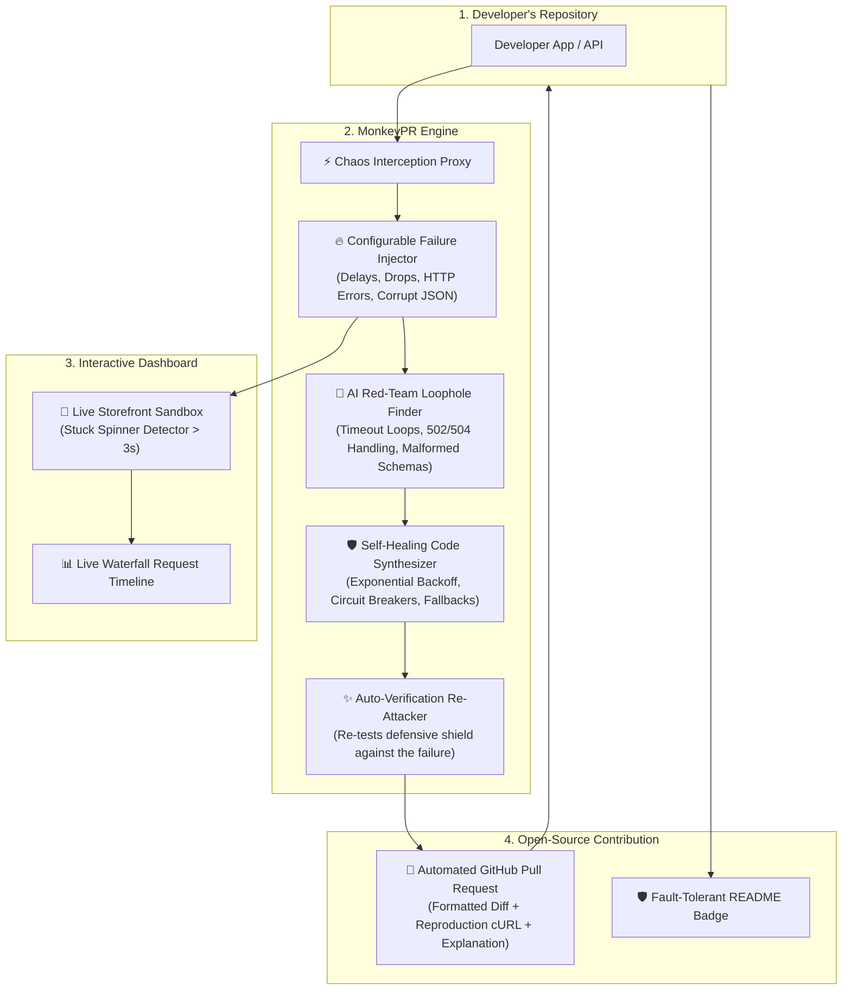

# 🐒 MonkeyPR — Autonomous AI Chaos Engineering & Auto-Healing PR Contributor

> **"Deliberately break your repo before production does. An AI Red-Team bot that tests your code against chaotic network failures and automatically submits self-healing GitHub Pull Requests."**

[](https://github.com/raghav-sharma-ai/MonkeyPR)
[](https://opensource.org/licenses/MIT)
[](https://github.com/raghav-sharma-ai/MonkeyPR)
[](https://fastapi.tiangolo.com)
[](https://nextjs.org)

---

## 📌 Executive Summary

Modern software breaks not because developers write bad logic, but because **the real-world network is unpredictable**. Upstream microservices crash, database queries hang, payment gateways time out, and APIs return malformed JSON.

In traditional open-source development:
1. **Maintainers have no time** to write complex resilience simulations or defensive retry backoffs.
2. **Users experience frozen UIs**, infinite loading spinners, and unhandled 500 error screens.
3. **Chaos engineering tools** (like Netflix Chaos Monkey) only break servers — they **never write code to fix the problem**.

**MonkeyPR bridges this gap**. It is an autonomous AI chaos engineering agent that:
- Intercepts requests through an in-memory chaos proxy.
- Injects realistic network failures (extreme delays, dropped packets, 502 Bad Gateways, 429 Rate Limits, corrupted JSON payloads).
- Detects UI/backend failure modes (infinite spinning loaders, unhandled crashes).
- **Writes clean, production-ready defensive patches** (exponential backoff, circuit breakers, timeout guards, schema fallbacks).
- **Submits a verified, human-reviewed GitHub Pull Request** directly into the developer's repository with one click.

---

## 🏆 Why MonkeyPR Belongs to "AI in Open Source"

| Hackathon Question | Traditional Open Source | MonkeyPR Solution |
| :--- | :--- | :--- |
| **Who fixes reliability bugs?** | Overwhelmed human maintainers during late-night production outages. | **Autonomous AI Agent** that proactively identifies loopholes and submits self-healing PRs. |
| **Can any developer use it?** | Requires complex cloud Kubernetes/Gremlin setups costing thousands of dollars. | **100% open-source tool** that runs locally or hooks into any public GitHub repo in seconds. |
| **Is it safe?** | Black-box bots that push unverified code directly into `main`. | **Human-in-the-Loop approval**: provides cURL reproduction proof, side-by-side diffs, and requests maintainer permission before raising a PR. |
| **Open-Source Impact** | Repositories remain fragile until users report bugs. | Hardens any open-source package with resilience shields and provides a verified badge for its README. |

---

## 🏗️ System Architecture & Workflow



---

## 🌟 Detailed Features Explained in Easy Words

### 1. ⚡ HTTP Chaos Proxy
- **What it is**: An intelligent proxy layer placed between client applications and backend APIs.
- **In Plain English**: Think of this proxy as an "honest postman who occasionally drops letters, delays deliveries, or tests how well the recipient handles an unexpected package."
- **Why it matters**: Developers normally test with fast `localhost` connections (0-5ms). The chaos proxy replicates real-world cellular, transatlantic, or degraded microservice networks.

### 2. 🔥 Failure Injector (Configurable Rules)
Developers can toggle and configure faults in real time without restarting servers:
- **Artificial Latency (0 - 7000ms)**: Introduces precise artificial latency to verify timeout handling and loading states.
- **HTTP Error Injection**: Returns instantaneous `500 Internal Server Error`, `502 Bad Gateway`, `504 Gateway Timeout`, or `429 Rate Limited`.
- **Packet Drop Simulation**: Abruptly severs connections with a 503 or dropped socket, mimicking dropped cellular towers or server restarts.
- **Malformed JSON Payloads**: Returns truncated or syntactically broken responses (e.g., `{"status": "ok", "items": [CORRUPTED_BYTE`) to ensure the client parser doesn't crash the entire screen.
- **Pre-configured Chaos Presets**: One-click quick presets including *Cellular 3G Lag*, *Black Friday Surge (429)*, *Payment Gateway Outage (502)*, and *Total Network Blackout*.

### 3. 🛒 Live Storefront Sandbox & Stuck-Spinner Detector
- An embedded e-commerce checkout sandbox that exercises API calls through the proxy in real time.
- **Stuck-Spinner Detection**: If an API takes longer than 3000ms without client-side timeout guards, MonkeyPR highlights the UI with a persistent warning banner:
  > *"🚨 Infinite loading spinner detected! User would be permanently stuck on this checkout screen."*
- **Auto-Recovery with Exponential Backoff**: When the client shield is toggled, failed requests automatically retry with exponential delay (`500ms -> 1000ms -> 2000ms`), recovering seamlessly without freezing the checkout button.

### 4. 📊 Live Request Timeline & Waterfall Chart
- Real-time event waterfall visualizing every single request passing through the proxy.
- **Color-Coded Duration Bars**:
  - 🟢 **Fast / Normal** (< 800ms)
  - 🟡 **Slow / Degraded** (800ms - 2500ms)
  - 🔴 **Extreme Lag / Unhandled** (> 2500ms)
- Displays client request payload, injected rule type, status code, and millisecond duration.

### 5. 🤖 Autonomous Red-Team Loophole Finder
Rather than forcing developers to guess what could go wrong, MonkeyPR runs automated probes against standard endpoints:
1. **Unbounded Hanging Request Loophole**: Probes if the client has a finite request timeout.
2. **Unhandled 502/504 Microservice Outage**: Checks whether server outages trigger ugly stack traces or clean user-facing error boundaries.
3. **Missing Exponential Backoff & Retry**: Simulates temporary blips to verify if operations fail immediately or gracefully retry.
4. **Corrupted / Truncated JSON Payload**: Validates client-side parser safety when APIs return malformed strings.

Each loophole card displays:
- **Severity Badge** (`CRITICAL`, `HIGH`, `MEDIUM`).
- **Observed Crash / Vulnerability**: Exactly how the system failed during the probe.
- **Reproduction Proof (cURL)**: Exact command any developer can copy and paste into their terminal to reproduce the bug instantly.

### 6. 🛡️ Self-Healing Code Synthesizer & Auto-Verification
- Generates clean, idiomatic defensive code diffs showing the exact change required.
- **Human-In-The-Loop**: The code is never applied without maintainer approval.
- **Automated Verification Attack**: When the maintainer clicks *"Approve & Apply Shield"*, MonkeyPR deploys the shield and immediately launches a re-attack against the endpoint. If the endpoint survives without crashing, it awards the **"SHIELD VERIFIED"** badge and increments the repository resilience score.

### 7. 🚀 1-Click Pull Request Contributor
- Enter any GitHub repository URL (e.g., `https://github.com/your-username/your-repo`).
- Click **"Open PR on GitHub"** on any detected loophole.
- MonkeyPR uses the GitHub REST API to:
  1. Package the defensive diff.
  2. Write a clear, markdown-formatted PR description detailing the vulnerability, reproduction cURL, and architectural rationale.
  3. Submit the Pull Request to the repository.
  4. Return a clickable link directly to the newly opened PR (`#1`, `#2`, etc.).

### 8. 🏷️ README Resilience Shield Badge
Showcase to users and open-source contributors that your codebase is battle-tested against network failures:
```markdown
[](https://github.com/raghav-sharma-ai/MonkeyPR)
```

---

## 🚀 How to Apply MonkeyPR to Any Repository

You can apply MonkeyPR to any repository in 3 easy steps:

### Step 1: Start MonkeyPR

#### Option A: One-Command Runner (Recommended)
```bash
# Navigate to the project directory and run the launcher:
cd Documents/RepoMind
./start.sh
```
This automatically boots both the FastAPI backend (port 8000) and the Next.js frontend (port 3000), checks port availability, and displays live URLs.

#### Option B: Manual Two-Terminal Runner
```bash
# Terminal 1: Backend (FastAPI)
cd Documents/RepoMind
source .venv/bin/activate
uvicorn backend.app.main:app --host 0.0.0.0 --port 8000 --reload

# Terminal 2: Frontend (Next.js)
cd Documents/RepoMind/frontend
npm run dev
```

### Step 2: Open Dashboard and Enter Target Repository
1. Open your browser at `http://localhost:3000/chaos-lab`.
2. In the **Target Repository** field, enter your repository URL:
   `https://github.com/your-org/your-awesome-repo`
3. Click **"Launch Red-Team Probe"**.
4. Review the detected vulnerabilities, reproduction cURL commands, and proposed diffs.

### Step 3: Approve & Receive Pull Request
1. Click **"Open PR on GitHub"** on any loophole you want to protect.
2. MonkeyPR programmatically opens the defensive Pull Request on your target repository!
3. Review and merge the PR on GitHub to make your codebase fault-tolerant.

---

## 💻 Tech Stack

- **Frontend**: Next.js 16 (App Router), React 19, TypeScript, Tailwind CSS, Lucide React icons.
- **Backend**: FastAPI (Python 3.11+), Uvicorn, Async HTTPX, Pydantic v2.
- **Proxy Engine**: Asynchronous ASGI in-memory rule engine with non-blocking sleep hooks and response transformation.
- **Integration**: GitHub REST API v3 for automated Pull Request synthesis and branch management.

---

## 📁 Repository Structure

```
MonkeyPR/
├── backend/
│   ├── app/
│   │   ├── api/
│   │   │   ├── routes_chaos.py       # Chaos proxy, rules, logging, Red-Team bot, PR generator
│   │   │   └── ...
│   │   └── main.py                  # FastAPI application entrypoint
│   └── requirements.txt             # Python dependencies
├── frontend/
│   ├── src/
│   │   ├── app/
│   │   │   └── chaos-lab/page.tsx    # Standalone Chaos Lab Route
│   │   ├── components/
│   │   │   └── chaos/
│   │   │       └── ChaosLabView.tsx  # Full interactive UI (Control Deck, Storefront, Waterfall, Red-Team)
│   │   └── lib/
│   │       ├── api.ts                # API client with chaos & open-pr endpoints
│   │       └── types.ts              # TypeScript definitions
│   └── package.json
└── README.md                        # Documentation & Quickstart Guide
```

---

## 🛡️ License

This project is licensed under the **MIT License** — free to use, modify, and distribute for any open-source or commercial project.

---

*Built with ❤️ for the Global AI & Open Source Community.*
